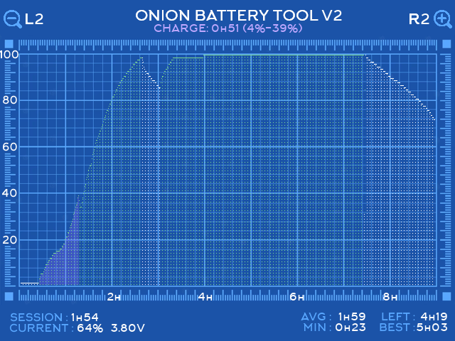

# Battery Monitor V2: changes

The changes to Onion's Battery Monitor app (`src/batteryMonitorUI`).

- **Base:** OnionUI/Onion `main` at `07505ea5`. That is also the build on the test device, v4.4.0-beta-20260120-07505ea5.
- **Tested on:** a Miyoo Mini Plus. It has the AXP221 battery gauge, so `DEVICE_ID` is 354.
- **Files changed:** `batteryMonitorUI.c` and `batteryMonitorUI.h`; and, in separate commits, `src/batmon/batmon.c` and `src/batmon/batmonDB.h`.
- **batmon**, the background service that writes the battery log, changes in two places, in separate commits: it reads the battery at once after a wake from sleep, and it logs clock times.

*The current build on the device, 2026-11-02:*
- *L1 has selected the charge `CHARGE: 0h51 (4%-39%)`, at the left of the graph. The area under its curve has a light purple tint.*
- *Charging is drawn green and time on battery white.*
- *AVG sits over MIN, and the voltage follows CURRENT.*

## Summary

| Area | Before | Now |
|---|---|---|
| Refresh | The log was read once, at start. | The log is re-read when batmon writes to it. Checked every 15 s. |
| CPU while open | One core at 100 %: the input loop never slept. | About 0.1 % of a core while idle, as measured. |
| Colours | Charging drawn pink-red. | Charging green; a selection shows as a purple tint under the curve. |
| CURRENT | Percent only. | Percent and battery voltage. |
| LEFT | A straight line through the current session. | The history's discharge curve, scaled by the current session's load. |
| BEST | batmon's all-time record. | The longest finished session in the log. |
| AVG, MIN | None. | Average and shortest finished session in the log. |
| L1 / R1 | Zoom. | Step through sessions on battery and charges. |
| L2 / R2 | Zoom (same as L1/R1). | Zoom. The corner icons read "L2" and "R2". |
| Title | ONION BATTERY TOOL | ONION BATTERY TOOL V2 |
| SELECT menu | None. | Live AXP221 hardware fuel gauge & PMIC telemetry, battery capacity setting (<2600 mAh>), 100% sync, and hardware calibration. Safeguarded for non-AXP hardware. |
| Robustness | Out-of-bounds writes on bad durations; a crash on a missing picture. | Both guarded. The fixes come from Amiga500/Onion. |

## Changes in detail

### Refresh while the app is open

The original read the log once at start, so the percentage and the graph froze while the app was open.

- batmon checks the battery every 15 s (`CHECK_BATTERY_TIMEOUT_S`). It writes the log when the percentage changes, and every 10 min for the current entry's duration.
- The app checks the log file's mtime at the same pace (`DB_CHECK_INTERVAL_MS`, 15 s).
- When the mtime has moved, the app waits 1 s (`DB_SETTLE_MS`) and recomputes everything.
  - The card is FAT, where mtime has 2 s steps.
  - batmon writes two statements back to back: the duration update, then the new row.
- `reset_graph()` clears the graph before each recompute. The estimate code relies on a cleared array.
- **After a wake from sleep:**
  - Onion's sleep stops every process with SIGSTOP, batmon included, and continues them on wake (`keymon.c`, `suspend()`/`resume()`). batmon then reads the battery at its next 15 s check. Until then, the app showed the percentage from before the sleep.
  - The app detects the wake as a gap of more than 2 s between loop passes (`WAKE_GAP_MS`). It then checks every second (`DB_FAST_CHECK_INTERVAL_MS`) for 30 s (`WAKE_FAST_CHECK_MS`), so batmon's first reading after the wake shows within about a second.
  - batmon itself waited up to 15 s after a wake. The separate commit "batmon: read the battery at once after a wake from sleep" makes it read the battery on SIGCONT, which helps MainUI's percentage too. It is the only change outside `src/batteryMonitorUI`.

### CPU use

The original input loop called `SDL_PollEvent` without pausing, so it kept one core busy.

- **First fix:** a 16 ms pause. In one 60 s measurement the process used 3.07 s of CPU, about 5 % of a core, with 64 wakeups/s. That run was not controlled: the app may have been used during it.
- **Current build:**
  - while idle, buttons are polled every 50 ms (`INPUT_POLL_IDLE_MS`);
  - for 1 s after a button event, every 16 ms (`INPUT_POLL_ACTIVE_MS`, `INPUT_ACTIVE_MS`), so scrolling and key repeat stay smooth.
- **Measured** with the app open and idle for 60 s, starting 10 s after launch:
  - 0.05 s of CPU, about 0.1 % of a core;
  - 29 wakeups/s.

### Voltage after CURRENT

The app reads batmon's last reading from `/tmp/.axp_result`, at the same 15 s pace.

- **Mini Plus (354):** the file holds `axp_test` output with the voltage in mV. It is shown as `3.94V`.
- **Mini (283):** batmon writes the smoothed ADC value there. It is converted with batmon's own formula, `(adc - 148) / 100` V. Nothing is shown while charging, because batmon then stores no reading.

The voltage uses the value font and colour (white), like the percentage.

### LEFT from the history

`estimate_left_seconds()` works in three steps:

1. **Discharge curve.** From the log, the app works out how long each 1 % lasted at each level.
   - A row at level *a* followed by level *b* < *a* spreads its time over the levels from *a* down to *b*+1.
   - Drops of more than 5 % at once (`LEFT_MAX_STEP`) are gauge jumps, so they are skipped. The log has one from 100 % to 30 % in under a minute.
   - Each level averages its neighbours within ±2 levels (`LEFT_CURVE_WINDOW`).
   - The current session is left out of the curve, because step 2 measures it against the curve. It is used only when there is no other history.
2. **Load factor.** The app compares the current session's real time over the levels it has drained with the curve's time for those levels.
   - The ratio is clamped to 0.33–3.
   - It is trusted in proportion to the percent drained, fully from 60 % (`LEFT_FULL_TRUST_PCT`).
3. **Result.** LEFT is the curve's time from the current level to 0 %, times the factor, less the time already spent at the current level.

The blue estimate line now runs from the current reading down to 0 % at the estimated time. The 15 h plausibility limit stays.

**Backtest on the device's log**
- **Data:** 1000 rows, about 34.5 h awake, 17 finished sessions. Two of the sessions went from 99 % to below 10 %.
- **Method:** each of those two sessions was predicted from the rest of the log, at every entry, for the time down to 10 %.
- **Scripts:** Python scripts in a scratch folder, not in this repository.

| Method | Mean error, session A | Mean error, session B |
|---|---|---|
| Old: straight line through the session | 22.6 min | 29.2 min |
| History curve only | 7.3 min | 10.5 min |
| **Curve + load, full trust at 60 % (chosen)** | **3.6 min** | **4.3 min** |

**Caveats**
- Only two full discharges were available, so treat the numbers as indicative.
- The last 10 % rests on a single session. On this battery it lasted almost 2 h, because the gauge holds low readings for a long time.
- The estimate improves by itself as the log gathers more full discharges.

### BEST, AVG and MIN from the log

batmon keeps the log as a FILO of the newest 1000 rows (`FILO_MIN_SIZE`). On the test device that was about 34.5 h of awake time.

- The three values are computed from finished sessions in that log. A session is finished when the log holds its start (a charging entry before it) and its end (the charger plugged in), as batmon defines a session.
- **BEST** is the longest such session.
  - It used to come from `device_specifics.best_session`, an all-time record that may date from a fresher battery.
  - On the test device it was 5h45 before and is 5h03 now.
- **AVG** and **MIN** leave out sessions under 20 min (`GRAPH_MIN_SESSION_FOR_ESTIMATION`). Short unplugs say nothing about battery life.
- **Layout:** AVG sits over MIN on the LEFT/BEST rows. Values are right-aligned before "LEFT :" and "BEST :", and the labels are aligned with each other.

### Stepping through sessions and charges (L1/R1)

- **L1** goes to the next older stretch, and **R1** to the next newer one. R1 from the newest returns to the normal view.
- Stretches on battery and charges come in time order.
- The view scrolls so that the stretch's start is just inside the left edge. It stays in view when zooming.
- Stretches under 5 min (`SESSION_MARK_MIN_LENGTH`) are skipped, because they are charger flickers. The stretch going on now is always included.
- **Highlight:** the area under the selected stretch's curve is tinted. A session on battery gets Onion's purple, `#8861FC`, from Onion's boot screens. A charge gets the charging green at 30 %, because purple over the green fill turned it grey.
  - The curve itself keeps its own colour.
  - The caption under the title is a lighter purple for a session, `#BEA8FF`, so it reads on the blue background, and the charging green for a charge.
- **Caption, session on battery:** `SESSION: 1h58 (100%-42%)`. `NOW` is added for the current one.
- **Caption, charge:** `CHARGE: 0h46 (86%-100%) +3h39 AT 100%`.
  - The first time is how long the charge took to reach its last level.
  - "+… AT 100%" is the time left on the charger afterwards. It is shown when it exceeds 5 min.
  - The Mini logs no percentage while charging, so its captions show the time only.

Without clock times (see the next section), charge times count only time with the console awake. batmon does not run while the console sleeps or is off, so charging in that state is not in the log.

### Clock times in the log

The log used to hold only levels and awake durations, so it could not tell when anything happened, or how long the console slept.

**batmon**
- The log gets a sixth column, `start_time`: the Unix time when the entry began. It is NULL while the clock is clearly unset, before 2020.
- `open_battery_log_db()` adds the column to an older log once per process, with `ALTER TABLE`. The error when it already exists is ignored.
- The column is appended last. Older readers (`SELECT *` with the first five columns) and older writers (which name their columns) keep working. Old entries keep NULL.
- The time is taken only when an entry is written, as before. Nothing runs while the console sleeps (batmon is stopped then), so battery use in sleep is unchanged.

**The app**
- A stretch has clock times only when every entry in it has one, and its clock span is at least 90 % of its awake time. A clock set back breaks that rule, as on the Mini after a power-off.
- **Charge times** come from the clock, so charging while asleep counts too. They show the time to reach the last level and the time on the charger after it.
- **A session's sleep and what it cost:** `+3h10 SLEEP -12% (3.8%/H)`.
  - **Sleep:** the clock gaps between consecutive entries, each gap being the newer entry's start less the older entry's start and awake duration. batmon is stopped while asleep, so its durations leave the sleep out.
  - **Which gaps count:** from 2 min (`SLEEP_GAP_MIN`) and from 10 % of the older entry's awake time (`SLEEP_GAP_MIN_PCT`). batmon's count runs a few percent slow, because each loop pass takes a little over a second.
  - **The cost:** the level lost across those gaps. batmon reads the battery at once on wake, so the first entry after the wake shows the level then.
  - **When it is shown:** from 5 min of sleep in total (`SLEEP_MIN_SHOWN`). The rate per hour appears from 30 min (`SLEEP_RATE_MIN`), because shorter sleeps are too coarse at 1 % steps.
  - Only the entries around a sleep need clock times, not the whole session.
- **The start date and time** (`02.11 18:05`, local time) are shown on the Mini Plus only, which has a hardware clock.
  - The Mini has none: Onion restores the time saved at shutdown, so its dates would be wrong.
  - Spans within one boot are still right on the Mini, so it gets the sleep and charge times.
- **Local time** comes from `TZ`, which runtime.sh passes to what it launches. When `TZ` is missing, the app reads Onion's `config/.tz` itself.

### Zoom on L2/R2, and "V2"

- Zoom moved to L2/R2, because L1/R1 now step through stretches.
- **Icons:** the zoom icons read "L2" and "R2", with the "2" drawn in the title font at the height of the icon's letter. The right icon's R is moved left to make room before the magnifier.
- **"V2":** drawn after the title in the background image, in Arkhip at 20 px. That size matches the title's letters.

### Live AXP221 PMIC & Battery Telemetry Menu (SELECT button)

Pressing `SELECT` opens a dedicated overlay with live readings and hardware controls:
- **Live telemetry (1 Hz poll):**
  - Voltage (mV from registers `0x78/0x79`), live charge/discharge current (mA from `0x7A/0x7B` and `0x7C/0x7D`), battery level (`0xB9`), energy remaining (mAh from Coulomb counter `0xE2/0xE3`), and design capacity (`0xE0/0xE1`).
  - Dual gauge readings: OCV % (`0xE4 & 0x7F`, voltage-based) and CC % (`0xE5 & 0x7F`, hardware Coulomb counter).
- **Enlarged instrument cards & typography:**
  - Both telemetry tables enlarged to 186 px height with row dividers, generous spacing (34 px pitch), and full `font_Arkhip` (15 pt) typography for superior legibility on the 3.5" 640x480 screen.
  - Cramped explanation text box was removed from the screen and moved to documentation.
- **Understanding the dual fuel gauge readings (Hardware Guide):**
  - **OCV % (Open Circuit Voltage, register `0xE4 & 0x7F`):** Voltage-based battery estimate. Reacts instantly to cell voltage, but fluctuates during gameplay due to CPU/GPU load (IR drop across internal cell resistance) and rebounds when idle or in menus.
  - **CC % (Coulomb Counter, register `0xE5 & 0x7F`):** Hardware Coulomb counter. Directly integrates the current flow (milliampere-hours) entering and leaving the cell via high-speed ADC sampling in 1.456 mAh steps (`0xE2/0xE3`). Delivers smooth, monotonic, highly accurate tracking immune to momentary voltage dips.
  - **Blended / Calibrated PMIC state:** When calibrated, the AXP221 PMIC blends both metrics: it uses the Coulomb counter for smooth linear tracking, with OCV bound checks to prevent drift over time.
- **Battery settings & actions:**
  - Capacity adjustment (`< 2600 mAh >` with LEFT/RIGHT, range 1500–4000 mAh in 50 mAh steps, saved to registers `0xE0/0xE1` via `[A]`).
  - Sync Coulomb counter to 100% (`[A]` seeds `0xE2/0xE3` to design capacity upon full charge).
  - Autocalibration toggle (`0xB8` bit 5) with a modal confirmation dialog explaining the 100% -> empty -> 100% learning cycle.
- **Safeguards & Performance:**
  - Models without AXP221 (e.g. Miyoo Mini v1-v3) cleanly display "HARDWARE FUEL GAUGE NOT AVAILABLE" without errors or invalid I2C writes.
  - Zero I2C overhead when the menu is closed; rate-limited to 1 Hz when open. Idle CPU usage remains ~0.1%.

### Fixes taken from Amiga500/Onion and local fixes

Both come from commit `e1942134` ("fix(batmon): battery monitor threshold, UI and charging state"):
- `compute_graph()` stops when a row's index falls outside `graphic[]`. Before, corrupt or implausible durations wrote out of bounds.
- `safeBlitSurface()` skips a picture that failed to load, instead of crashing.
- **Oldest run flush (2026-11-03):** `compute_graph()` pushed marks to `session_marks[]` only when `is_charging != run_charging`. At the end of the query, the oldest run was never flushed, dropping the initial session (e.g. charging in a fresh database) from L1/R1 navigation. Also allow runs whose clock span >= 300 s even if awake time was less (charging in sleep).

## Building

The app was built without Onion's Docker toolchain.

- **Compiler:** Arm GNU Toolchain 13.3 on Windows, as a dynamic executable for the device's glibc 2.28.
- **Startup code:** `start.S` and `start_init.c` replace `crt1.o`.
- **Compatibility:** `glibc_compat.h` pins `exp` and `log` to `GLIBC_2.4`, and `stat64` goes to `__xstat64` through `-Wl,--wrap=stat64`.
- **Libraries:** SDL, SDL_image and SDL_ttf from `static/build/miyoo/lib`; sqlite3 from `lib/`.
- **Headers:** SDL 1.2.15 headers.
- **Result:** only `GLIBC_2.4`, `2.7` and `2.17` symbols are needed.

batmon was built the same way, with two additions:
- `__dso_handle` is defined, because `atexit()` needs it without `crtbegin.o`;
- `pthread_cancel` is pinned to `GLIBC_2.4`.

On the test device, the new batmon replaced the old one while running. It was started like `runtime.sh` starts it: the same environment, working directory `.tmp_update/logs`, and a parent shell. The parent shell matters because keymon stops a process for sleep only when its parent PID is above 2. From the next boot, `runtime.sh` starts the new binary itself. The original is backed up.

With Onion's own toolchain, the standard `make` in `src/batteryMonitorUI` and `src/batmon` should work unchanged.

## Not yet done

- [ ] Commit.
- [ ] Later: a pull request to RedOnion (Amiga500/Onion, base `feat/open-mainui`).
  - The patch applies there with a few trivial conflicts. Use `HAS_AXP()` for the voltage, which covers the Mini Flip too.
  - Planned: drop "V2" from the title; move the LEFT, AVG, MIN and BEST logic into a header with host tests; split into three PRs (refresh and CPU; voltage, stats and LEFT; navigation, colours and fill).
  - The PR text must state that BEST's meaning changes, and that only a Mini Plus was tested.
- [x] batmon checks the battery at once on SIGCONT (wake from sleep). Done in its own commit and running on the test device. For RedOnion it fits as a separate PR.

### Colours

| Element | Colour | Why |
|---|---|---|
| Graph on battery | white | Neutral, and the most readable on the blue background. |
| Graph while charging | green `#7DDB8F` (was pink-red `#FFAAAA`) | Green reads as charging; red reads as a low-battery warning. White and green also differ in lightness, so they stay apart with colour-blindness. |
| Fill under the curve | the curve's colour at 30 %, solid (was a dot grid every 4 px) | The dot grid hid the colours: charging and battery looked alike. |
| LEFT estimate line | pastel blue `#59A7FF`, still with the dot grid | Unchanged, so the prediction reads differently from the logged history. |
| Selected session on battery | purple `#8861FC` tint under the curve | Onion's purple. A purple curve over a purple tint was hard to see, so the curve keeps its own colour. |
| Selected charge | green `#7DDB8F` tint at 30 % under the curve | A purple tint over the green fill turned it grey, and the charge no longer looked like one. |
| Caption of the selection | light purple `#BEA8FF` for a session, green `#7DDB8F` for a charge | The darker purple was hard to read on blue; the green matches the charge. |
