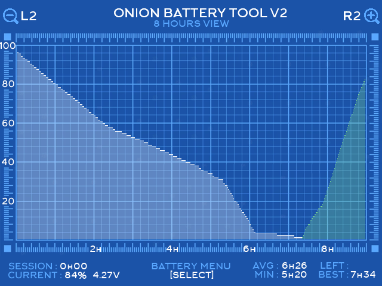

# Onion Battery Monitor V2 (Enhanced Edition)

[](https://github.com/OnionUI/Onion)
[](https://github.com/OnionUI/Onion)
[](https://www.gnu.org/licenses/gpl-3.0)

An enhanced rework of Onion OS's **Battery Monitor** app for the **Miyoo Mini** and **Miyoo Mini Plus**.

Featuring **live hardware PMIC telemetry**, **Coulomb Counter energy tracking (mAh)**, **hardware battery calibration**, and **rich session history analysis**.

---


---

## ⚡ Why This Exists (The Problem & The Fix)

### The Problem with Miyoo Mini Plus Battery %
Many Miyoo Mini Plus owners notice that their battery percentage behaves erratically:
- The battery percentage suddenly drops by 15–25% when starting a demanding emulator (PS1, GBA, etc.).
- The console stays stuck at 10% or 4% for up to 2 hours of gameplay.
- After waking the console from sleep, the battery percentage jumps up or down unexpectedly.

This happens because the stock firmware relies solely on **Open Circuit Voltage (OCV)** to estimate battery levels. Under heavy CPU/GPU load, cell internal resistance causes the voltage to sag, misleading the system into reporting a much lower percentage than what actually remains in the cell.

### The Fix: Hardware Coulomb Counting & PMIC Calibration
The Miyoo Mini Plus includes an **X-Powers PMIC chip (AXP223 / AXP221)** equipped with an integrated hardware **Coulomb Counter**. When configured, it directly measures the actual electrical charge (milliampere-hours, mAh) flowing into and out of the battery in real-time.

**Battery Monitor V2 unlocks this hardware capability:**
1. **Live Instrument Panel ([SELECT] Menu):** View real-time voltage, instantaneous power draw / charge current (mA), remaining capacity (mAh), and true cell percentage.
2. **Dual Fuel Gauge Metrics:** Compare the fast voltage-based estimate (**OCV %**) against the smooth, monotonic hardware Coulomb counter (**CC %**).
3. **Hardware Battery Calibration Wizard:** A guided 1-cycle learning process that teaches the PMIC your cell's true degraded or upgraded capacity, completely eliminating sudden battery cliffs and false low-battery alerts.
4. **Interactive Capacity Adjustment:** Adjust your battery capacity profile (`< 2600 mAh >` in 50 mAh steps) or sync the counter to 100% with a single click.

---

## ✨ Key Features

### 1. Live Telemetry & Calibration Menu (Press `[SELECT]`)
* **Real-time Telemetry (1 Hz poll):**
  * **Battery Voltage:** Precise cell voltage (e.g. `4.19 V`).
  * **Power Draw / Charge:** Instantaneous mA draw (e.g. `-385 mA` discharging, `+1200 mA` fast charging).
  * **Battery Level:** Current system battery percentage.
  * **Energy Remaining:** True energy remaining in the cell in **milliampere-hours (mAh)**.
  * **Total Capacity:** Battery total capacity register (set manually or learned by the PMIC).
* **Dual Fuel Gauge Readings:**
  * **Voltage (OCV):** Quick voltage-based reading. Sensitive to instantaneous game load.
  * **Coulomb Ctr (CC):** Integrated energy flow tracking. Highly accurate and immune to momentary load dips.
  * **Fuel Gauge & Calibration Status:** Real-time feedback on PMIC state (`Active`, capacity learning `Enabled`/`Off`, correction `In progress`/`Idle`).
* **Hardware Controls:**
  * **Battery Capacity (`< 2600 mAh >`):** Changeable with `[D-Pad LEFT/RIGHT]`, saved to hardware registers with `[A]`.
  * **Sync Counter to 100%:** Instant recalibration to design capacity upon full charge.
  * **Shutdown Voltage (`< 2.9 V >`):** PMIC auto power-off threshold `Voff` (REG 31H, 2.6–3.1 V in 0.1 V steps, default 2.9 V). Changeable with `[D-Pad LEFT/RIGHT]`, saved with `[A]`. This is a **hard power cut** done by the PMIC — the game is not saved, so keep Onion's own low-battery save/shutdown above it.
  * **Battery Health Test (~45 s):** Measures internal resistance from voltage sag: idle baseline (screen dimmed), then both CPU cores at 100% load at 1200 MHz and 1600 MHz. Rates the cell EXCELLENT / GOOD / AGED / POOR. Requires ≥ 3.60 V on battery (no charger); aborts below 3.50 V or with `[B]`; CPU clock, governor and brightness are always restored. Turn Wi-Fi off first for the cleanest reading.
  * **Capacity Learning Toggle:** Enable or disable the PMIC capacity correction function with a confirmation modal (verified by register read-back).
* **Ultra-Low CPU Usage:**
  * Consumes **<0.1% CPU** when idle (sleeps 50 ms in kernel).
  * Zero I2C overhead during normal gaming; only polls when the menu is active.

### 2. Enhanced Graph & Session Tracking



* **Session & Charge Navigation:** Use **`[L1]` / `[R1]`** to step through previous gaming sessions and charges.
* **Distinct Charging Curves:** Charges are plotted in **green** with full duration and percentage gained.
* **Zoom Levels:** Use **`[L2]` / `[R2]`** to switch between 1-hour, 2-hour, and 4-hour grid zoom profiles.
* **Accurate Drain Predictions:** The `LEFT` metric projects remaining runtime by scaling your historical discharge curve against your current gaming session's load.
* **Sleep Drain Tracking:** Accurately logs duration and percentage lost during sleep mode (e.g. `+3h10 SLEEP -12% (3.8%/H)`).
* **Session Stats (`AVG` / `MIN` / `BEST`):** Computed from **finished** sessions only, i.e. sessions that end with the charger being plugged in. A running session, even one longer than the record, appears in `BEST` only after you plug in the charger. Durations come from Onion's `batmon` log, which is written when the percentage changes or at least every 10 minutes. If the console dies by a hard power cut, the session's last few minutes may be missing.

---

## 🎮 Controls Reference

| Button | Screen | Action |
|:---|:---|:---|
| **`[SELECT]`** | Graph Screen | Open / Close Live Hardware Telemetry & Calibration Menu |
| **`[D-Pad UP / DOWN]`** | Telemetry Menu | Select action (Capacity / Shutdown Voltage / Sync 100% / Capacity Learning / Battery Test) |
| **`[D-Pad LEFT / RIGHT]`** | Telemetry Menu | Adjust capacity in 50 mAh increments / shutdown voltage in 0.1 V steps |
| **`[A]`** | Telemetry Menu | Save capacity or shutdown voltage / Sync counter to 100% / Confirm capacity learning |
| **`[B]`** | Telemetry Menu | Back to Graph Screen / Cancel modal dialog |
| **`[L1] / [R1]`** | Graph Screen | Step backward / forward through play sessions and charges |
| **`[L2] / [R2]`** | Graph Screen | Zoom in / out (1h, 2h, 4h per division) |
| **`[D-Pad LEFT / RIGHT]`** | Graph Screen | Scroll time axis horizontally |
| **`[MENU]`** | Anywhere | Exit application cleanly |

---

## 📦 Installation (Drop-in Replacement)

### Method A: Via MicroSD Card (Recommended)
1. Download **`BatteryMonitorUI_v2.0_OnionOS.zip`** from the [Releases](https://github.com/ksielick/batterymonitor-miyoo/releases) page.
2. Power off your console and insert the MicroSD card into your computer.
3. *(Optional but recommended)* Rename or back up your existing `App/BatteryMonitorUI` folder on the SD card (e.g. to `BatteryMonitorUI.bak`).
4. Extract the `BatteryMonitorUI` folder from the ZIP directly into the **`App/`** directory on your SD card:
   ```
   SDCARD/
   └── App/
       └── BatteryMonitorUI/
           ├── batteryMonitorUI
           ├── launch.sh
           ├── config.json
           └── res/
   ```
5. Put the MicroSD card back into your Miyoo Mini and launch **Battery Monitor** from the **Apps** menu!

### Method B: Over Wi-Fi (Samba / SSH)
1. Turn on Wi-Fi on your Miyoo Mini Plus.
2. In Windows Explorer or macOS Finder, open the network share:
   `\\<miyoo-ip-address>\App`
3. Replace the `BatteryMonitorUI` folder with the one extracted from the release ZIP.

---

## 🔧 How to Calibrate Your Battery (Full Learning Cycle)

If your battery percentage drops abruptly under load, stays at 10% for hours, or jumps unexpectedly, the PMIC needs one complete discharge-and-charge cycle to learn the true electrical capacity of your cell:

> [!IMPORTANT]
> **Crucial Prep for Calibration:**  
> Temporarily set Onion's **Low batt.: Save and exit** to **Off** (*Apps → Tweaks → System* or *Settings → System*).  
> If Onion's software shutdown is active (e.g. at 1%), it will shut the console down prematurely before the hardware PMIC can detect the true bottom threshold of the discharge curve, preventing calibration from completing!

### Step-by-Step Calibration:
1. **Charge to 100%:** Plug in the charger and charge until the battery reaches 100% and current draw drops to near 0 mA (or the charging LED turns off).
2. **Enable Capacity Learning:** Open **Battery Monitor**, press **`[SELECT]`**, scroll down to `[ A: Enable capacity learning ]`, press **`[A]`**, and confirm. *Cap. Learning* will now read **Enabled**.
3. **Discharge Completely (Let it Power Off):** Unplug the charger and play normally until the console powers off completely on its own. **You must let the battery discharge fully** so the PMIC detects the real bottom limit of the cell. This is completely safe: the PMIC itself cuts power at the hardware **Shutdown Voltage** (`Voff`, REG 31H, default **2.9 V**), leaving a safe resting voltage of ~3.15 V in the cell.
4. **Recharge Straight to 100%:** Plug the charger back in and let it charge straight to 100% in one continuous, uninterrupted charge.

Once complete, the PMIC automatically calculates and writes the learned value into the battery total capacity register (`0xE0/0xE1`), visible in the `[SELECT]` menu as **Total Capacity** (e.g. `3167 mAh` on a stock 3000 mAh cell).

*(After calibration is complete, you can safely turn Onion's **Low batt.: Save and exit** back to `< 1% >` for everyday gameplay safety).*

### What the status fields mean (PMIC AXP22x, REG B8H)

| Field | Register bit | Meaning |
|:---|:---|:---|
| **Cap. Learning: Enabled / Off** | B8H bit 5 (RW) | Capacity correction function switch. It is a **persistent setting**, not a one-shot cycle — it stays *Enabled* after a successful cycle and keeps refining capacity as the cell ages. Leaving it enabled is safe and recommended. |
| **Correction: In progress / Idle** | B8H bit 4 | Whether the PMIC is correcting capacity right now. *Idle* after a full charge is normal. |
| **Battery Level `(est.)` suffix** | B9H bit 7 | Shown when the PMIC reports the percentage is not yet correctly calculated. |

Disabling learning (`[ A: Disable capacity learning ]`) keeps the learned capacity and the Coulomb counter running. The app reads the register back after every change and reports if the PMIC rejected it.

---

## ⚠️ Low Battery, Shutdown Voltage & Hard Power-Off

There are two independent ways the console shuts down on low battery:

| | Onion low-battery shutdown | PMIC `Voff` cut-off |
|:---|:---|:---|
| Trigger | Battery percentage (Onion setting) | Voltage under load falls below `Voff` (default 2.9 V) |
| Saves game / state | Yes | **No.** All outputs are cut immediately, with no documented delay |
| SD card | Clean | A write in progress (savestate, `batmon.db`) can be interrupted |
| Session log | Complete | Last minutes may be missing |

- **Is a deep discharge harmful?** No. 3.0–3.2 V resting voltage is a completely safe discharge floor for Li-ion cells. In real-world tests with `Voff` set to **2.9 V**, the console shut down when the cell was at **3.15 V resting voltage** (due to the momentary ~0.15–0.25 V sag under active gaming load), leaving a healthy safety reserve.
- **Raising `Voff` to 3.0–3.1 V** leaves a little more reserve in the cell. The threshold is compared under load, though: a load spike in a demanding game can then cut power while the resting voltage is still ~3.2 V.
- **Recommended:** keep Onion's low-battery shutdown enabled for everyday play. For a capacity-learning or endurance run without it, save often and plug in the charger at ~3.0 V. Plugging in also ends the session cleanly, so `BEST` gets the full duration.
- `Voff` is a PMIC register. It is kept while the battery stays connected, but it is not yet confirmed whether it survives a reboot. Check the menu after restarting.

Register-level details, datasheet sources and observed behaviour are in **[docs/AXP221_REGISTERS.md](docs/AXP221_REGISTERS.md)**.

---

## 🔍 Hardware Compatibility

| Model | Chipset | Supported Features |
|:---|:---|:---|
| **Miyoo Mini Plus** (`MIYOO354`) | SigmaStar SSD202D + AXP223/AXP221 | **Full Support:** Live voltage, mA draw, Coulomb Counter, mAh tracking, calibration menu, enhanced graph. |
| **Miyoo Mini v1 / v2 / v3** (`MIYOO283`) | SigmaStar SSD202D (No AXP) | **Graph & Session Features:** Session navigation (L1/R1), zoom (L2/R2), green charge curves, sleep stats. Displays *"Hardware Fuel Gauge Not Available"* when pressing `SELECT`. |

---

## 🛠️ Building from Source

The repository is self-contained with its own build and packaging scripts:

```sh
# Build binary (requires ARM GNU Toolchain 13.3 in PATH)
./build.sh

# Build and generate release ZIP in dist/
./package.sh
```

Key build flags & configuration:
- Dynamic executable with custom startup code (`start.S` / `start_init.c`).
- Glibc compatibility wrapper (`stat64` wrapped to `__xstat64@GLIBC_2.4`).
- Stripped binary size: ~50 KB.

**GitHub Actions:** every push builds the app on Ubuntu with the ARM GNU Toolchain 13.3.rel1 for Linux (cached) and uploads the `BatteryMonitorUI` folder as a build artifact (Actions tab → run → Artifacts). Pushing a `v*` tag (e.g. `v2.0`) also publishes a GitHub Release with `BatteryMonitorUI_<tag>_OnionOS.zip`. Locally, `build.sh` takes the toolchain from `$TOOLCHAIN`, falling back to a Windows (mingw) toolchain path.

For full technical details, version history, and architecture roadmap, see **[CHANGELOG.md](CHANGELOG.md)**. PMIC register notes: **[docs/AXP221_REGISTERS.md](docs/AXP221_REGISTERS.md)**.

---

## 📜 Credits & License
- Originally created by the **Onion UI team** ([OnionUI/Onion](https://github.com/OnionUI/Onion)).
- Battery stability fixes and safeguards based on improvements by **Amiga500** ([Amiga500/Onion](https://github.com/Amiga500/Onion)).
- Enhanced telemetry, Coulomb counter integration, UI overhaul, and calibration wizard by **ksielick**.
- Licensed under **GPL-3.0**.

