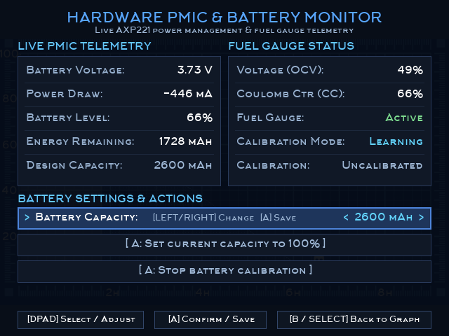

# Onion Battery Monitor V2 (Enhanced Edition)

[](https://github.com/OnionUI/Onion)
[](https://github.com/OnionUI/Onion)
[](https://www.gnu.org/licenses/gpl-3.0)

An enhanced rework of Onion OS's **Battery Monitor** app for the **Miyoo Mini** and **Miyoo Mini Plus**.

Featuring **live hardware PMIC telemetry**, **Coulomb Counter energy tracking (mAh)**, **hardware battery calibration**, and **rich session history analysis**.

---



---

## ⚡ Why This Exists (The Problem & The Fix)

### The Problem with Miyoo Mini Plus Battery %
Many Miyoo Mini Plus owners notice that their battery percentage behaves erratically:
- The battery percentage suddenly drops by 15–25% when starting a demanding emulator (PS1, GBA, etc.).
- The console stays stuck at 10% or 4% for up to 2 hours of gameplay.
- After waking the console from sleep, the battery percentage jumps up or down unexpectedly.

This happens because the stock firmware relies solely on **Open Circuit Voltage (OCV)** to estimate battery levels. Under heavy CPU/GPU load, cell internal resistance causes the voltage to sag, misleading the system into reporting a much lower percentage than what actually remains in the cell.

### The Fix: Hardware Coulomb Counting & AXP221 Calibration
The Miyoo Mini Plus includes an **X-Powers AXP221 PMIC chip** equipped with an integrated hardware **Coulomb Counter**. When configured, it directly measures the actual electrical charge (milliampere-hours, mAh) flowing into and out of the battery in real-time.

**Battery Monitor V2 unlocks this hardware capability:**
1. **Live Instrument Panel ([SELECT] Menu):** View real-time voltage, instantaneous power draw / charge current (mA), remaining capacity (mAh), and true cell percentage.
2. **Dual Fuel Gauge Metrics:** Compare the fast voltage-based estimate (**OCV %**) against the smooth, monotonic hardware Coulomb counter (**CC %**).
3. **Hardware Battery Calibration Wizard:** A guided 1-cycle learning process that teaches the AXP221 PMIC your cell's true degraded or upgraded capacity, completely eliminating sudden battery cliffs and false low-battery alerts.
4. **Interactive Capacity Adjustment:** Adjust your battery capacity profile (`< 2600 mAh >` in 50 mAh steps) or sync the counter to 100% with a single click.

---

## ✨ Key Features

### 1. Live Telemetry & Calibration Menu (Press `[SELECT]`)
* **Real-time Telemetry (1 Hz poll):**
  * **Battery Voltage:** Precise cell voltage (e.g. `4.19 V`).
  * **Power Draw / Charge:** Instantaneous mA draw (e.g. `-385 mA` discharging, `+1200 mA` fast charging).
  * **Battery Level:** Current system battery percentage.
  * **Energy Remaining:** True energy remaining in the cell in **milliampere-hours (mAh)**.
  * **Design Capacity:** Registered battery capacity setting.
* **Dual Fuel Gauge Readings:**
  * **Voltage (OCV):** Quick voltage-based reading. Sensitive to instantaneous game load.
  * **Coulomb Ctr (CC):** Integrated energy flow tracking. Highly accurate and immune to momentary load dips.
  * **Fuel Gauge & Calibration Status:** Real-time feedback on PMIC state (`Active`, `Learning`, `Calibrated`).
* **Hardware Controls:**
  * **Battery Capacity (`< 2600 mAh >`):** Changeable with `[D-Pad LEFT/RIGHT]`, saved to hardware registers with `[A]`.
  * **Sync Counter to 100%:** Instant recalibration to design capacity upon full charge.
  * **Calibration Cycle Toggle:** Start or stop the AXP221 hardware capacity learning cycle with a step-by-step confirmation modal.
* **Ultra-Low CPU Usage:**
  * Consumes **<0.1% CPU** when idle (sleeps 50 ms in kernel).
  * Zero I2C overhead during normal gaming; only polls when the menu is active.

### 2. Enhanced Graph & Session Tracking
* **Session & Charge Navigation:** Use **`[L1]` / `[R1]`** to step through previous gaming sessions and charges.
* **Distinct Charging Curves:** Charges are plotted in **green** with full duration and percentage gained.
* **Zoom Levels:** Use **`[L2]` / `[R2]`** to switch between 1-hour, 2-hour, and 4-hour grid zoom profiles.
* **Accurate Drain Predictions:** The `LEFT` metric projects remaining runtime by scaling your historical discharge curve against your current gaming session's load.
* **Sleep Drain Tracking:** Accurately logs duration and percentage lost during sleep mode (e.g. `+3h10 SLEEP -12% (3.8%/H)`).

---

## 🎮 Controls Reference

| Button | Screen | Action |
|:---|:---|:---|
| **`[SELECT]`** | Graph Screen | Open / Close Live Hardware Telemetry & Calibration Menu |
| **`[D-Pad UP / DOWN]`** | Telemetry Menu | Select action (Capacity / Sync 100% / Calibrate) |
| **`[D-Pad LEFT / RIGHT]`** | Telemetry Menu | Adjust design capacity in 50 mAh increments |
| **`[A]`** | Telemetry Menu | Save capacity setting / Sync counter to 100% / Confirm calibration |
| **`[B]`** | Telemetry Menu | Back to Graph Screen / Cancel modal dialog |
| **`[L1] / [R1]`** | Graph Screen | Step backward / forward through play sessions and charges |
| **`[L2] / [R2]`** | Graph Screen | Zoom in / out (1h, 2h, 4h per division) |
| **`[D-Pad LEFT / RIGHT]`** | Graph Screen | Scroll time axis horizontally |
| **`[MENU]`** | Anywhere | Exit application cleanly |

---

## 📦 Installation (Drop-in Replacement)

### Method A: Via MicroSD Card (Recommended)
1. Download **`BatteryMonitorUI_v2.0_OnionOS.zip`** from the [Releases](releases) page.
2. Power off your console and insert the MicroSD card into your computer.
3. *(Optional but recommended)* Rename or back up your existing `App/BatteryMonitorUI` folder on the SD card (e.g. to `BatteryMonitorUI.bak`).
4. Extract the `BatteryMonitorUI` folder from the ZIP directly into the **`App/`** directory on your SD card:
   ```
   SDCARD/
   └── App/
       └── BatteryMonitorUI/
           ├── batteryMonitorUI
           ├── launch.sh
           ├── config.json
           └── res/
   ```
5. Put the MicroSD card back into your Miyoo Mini and launch **Battery Monitor** from the **Apps** menu!

### Method B: Over Wi-Fi (Samba / SSH)
1. Turn on Wi-Fi on your Miyoo Mini Plus.
2. In Windows Explorer or macOS Finder, open the network share:
   `\\<miyoo-ip-address>\App`
3. Replace the `BatteryMonitorUI` folder with the one extracted from the release ZIP.

---

## 🔧 How to Calibrate Your Battery (3-Step Guide)

If your battery percentage drops abruptly under load or stays at 10% for hours, perform a hardware calibration cycle:

1. **Charge to 100%:** Plug in the charger and charge until the battery reaches 100% and current draw drops to near 0 mA (or the charging LED turns off).
2. **Engage Calibration:** Open **Battery Monitor**, press **`[SELECT]`**, scroll down to `[ A: Calibrate battery ]`, press **`[A]`**, and confirm. The *Calibration Mode* will now read **Learning**.
3. **Discharge Fully:** Unplug the charger and play normally until the console powers off by itself due to low battery (do not connect the charger during this time).
4. **Recharge to 100%:** Plug the charger back in and let it charge straight to 100% in one continuous charge.

Once complete, the AXP221 PMIC will update its internal learned capacity register. Your percentage indicator will now accurately reflect your battery's true capacity!

---

## 🔍 Hardware Compatibility

| Model | Chipset | Supported Features |
|:---|:---|:---|
| **Miyoo Mini Plus** (`MIYOO354`) | SigmaStar SSD202D + AXP221 | **Full Support:** Live voltage, mA draw, Coulomb Counter, mAh tracking, calibration menu, enhanced graph. |
| **Miyoo Mini v1 / v2 / v3** (`MIYOO283`) | SigmaStar SSD202D (No AXP) | **Graph & Session Features:** Session navigation (L1/R1), zoom (L2/R2), green charge curves, sleep stats. Displays *"Hardware Fuel Gauge Not Available"* when pressing `SELECT`. |

---

## 🛠️ Building from Source

The binary is compiled using the Windows-hosted **Arm GNU Toolchain 13.3** (`arm-none-linux-gnueabihf`) targeting Miyoo's glibc 2.28:

```sh
# Ensure toolchain and Onion source tree are present
./build_batmonui.sh
```

Key build flags:
- Dynamic executable with custom startup code (`start.S` / `start_init.c` from `tools-miyoo`).
- Glibc compatibility wrapper (`stat64` wrapped to `__xstat64@GLIBC_2.4`).
- Stripped binary size: ~50 KB.

---

## 📜 Credits & License
- Originally created by the **Onion UI team** ([OnionUI/Onion](https://github.com/OnionUI/Onion)).
- Battery stability fixes and safeguards based on improvements by **Amiga500** ([Amiga500/Onion](https://github.com/Amiga500/Onion)).
- Enhanced telemetry, Coulomb counter integration, UI overhaul, and calibration wizard by **ksielick**.
- Licensed under **GPL-3.0**.

